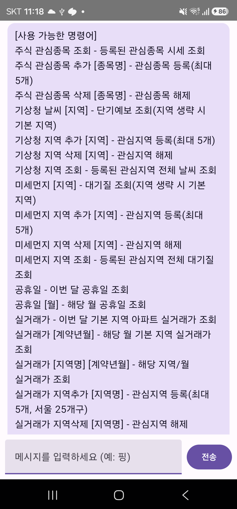

# phoneFlow

  

> 내 손 안의, 위치를 아는, 공공데이터 전용 Telegram.

phoneFlow는 대한민국 공공데이터포털(data.go.kr)과 한국도로공사
(data.ex.co.kr), 영화진흥위원회(kobis.or.kr) 등 여러 공공·민간
오픈 API의 정보를 채팅 한 줄로 바로 꺼내 쓸 수 있게 해주는 Android
앱입니다. 주식 시세부터 날씨, 미세먼지, 실거래가, 공휴일, 인천공항
운항정보, 지역 행사, 병원/응급실/당직병원, 사업자등록 상태, 영화
박스오피스, 고속도로 휴게소 정보까지 물어보면 바로 답해주고, 관심
종목/지역을 등록해두면 조건에 맞을 때 알아서 먼저 말을 걸어줍니다.

내부적으로는 Windows용 자동화 허브인
[NotebookFlow](https://github.com/dorafather/NotebookFlow)와 동일한
C++ Flow DSL 엔진(`libUtil`)을 JNI로 그대로 품고 있는 Android
네이티브 앱입니다 — 같은 시나리오 문법으로 동작하는 자매 프로젝트인
셈입니다.

---

## 핵심 기능

채팅창에 아래 명령어를 그대로 입력하면 됩니다(`help` 입력 시 전체
목록 안내). 대부분의 지역/이름 기반 조회는 직접 타이핑하는 대신
드로워(☰) 메뉴에서 자동완성 검색으로 바로 고를 수 있습니다.

### 금융·생활

- **주식** — 관심종목 시세 조회/추가/삭제(최대 5개), 전일 대비
  등락률이 임계값 이상 변동하면 매일 알림
- **실거래가** — 지역별·월별 아파트 매매 실거래가 조회, 관심지역
  등록(전국 시군구 검색 지원, 최대 5개)
- **사업자** — 사업자등록번호로 휴업/폐업/과세유형 상태 조회
- **영화** — 일별 박스오피스 순위 조회(날짜 지정 가능)

### 날씨·환경

- **기상청** — 지역별 단기예보 조회, 관심지역 등록 시 강수확률/
  강수 예보 기준 알림(전국 지역 검색 지원, 최대 5개)
- **미세먼지** — 지역별 대기질 조회, 관심지역 등록 시 통합지수
  나쁨 이상일 때 알림(최대 5개)
- **공휴일** — 이번 달/특정 월 공휴일 조회

### 교통·여행

- **인천공항** — 오늘 도착/출발편 요약 조회(공항코드로 특정 노선만
  필터링 가능)
- **행사** — 전국 행사/공연/축제 조회(지역·월 지정, "내 주변" GPS
  검색 지원)
- **주유소** — 고속도로 휴게소 주유소 유가 조회, "내 주변" GPS로
  가장 가까운 5곳 자동 조회
- **휴게소 대표메뉴** — 고속도로 휴게소 추천 메뉴 조회, "내 주변"
  GPS 검색 지원
- **휴게소 입점 브랜드** — 고속도로 휴게소 입점 브랜드/매장 영업시간
  조회

### 의료

- **병원** — 지역별 병원 요일별 진료시간/야간진료 여부 조회
- **응급실** — 지역별 응급실 실시간 가용병상 조회
- **당직병원** — 지역별 응급의료기관 요일별 진료시간 조회

  
   
  <code>help</code> 명령어 안내 화면 — 실기기 release 빌드 실측 캡처(일부 기능은 이후 추가됨)

> **참고**: 위치 기반 자동 지역 인식(지오펜싱) 등 설계 문서에 남아있는
> 일부 후속 기능은 아직 포함되지 않았습니다.

---

## 설치 방법

[Releases](../../releases) 페이지에서 최신 `phoneFlow.apk`를
다운로드해 Android 기기에 사이드로딩하세요.

1. 기기에서 APK 파일을 열고 "출처를 알 수 없는 앱" 설치를
   허용합니다(기기/Android 버전에 따라 "설치 중 확인" 또는
   "이 앱만 허용" 안내가 나올 수 있습니다).
2. 설치 후 앱을 실행하면 바로 채팅 화면이 뜹니다. 별도 로그인은
   필요 없지만, 명령어가 실제로 데이터를 받아오려면 아래 3번의
   인증키 입력이 먼저 필요합니다.
3. 드로워(☰) 메뉴 > **설정**에서 기능별로 필요한 기관(공급자)의
   인증키를 앱 안에서 직접 입력합니다(재빌드 불필요). 각 공급자
   카드를 탭하면 인증키 입력란과 "서비스별 활용신청" 바로가기,
   키 상태 점검(✅/❌) 기능을 볼 수 있습니다.
   - **공공데이터포털(K_DATA)** — [data.go.kr](https://www.data.go.kr)
     에서 무료 발급(주식/기상청/미세먼지/공휴일/실거래가/인천공항/
     행사/병원/응급실·당직병원/사업자 조회에 필요)
   - **한국도로공사(EX)** — [data.ex.co.kr](https://data.ex.co.kr)
     에서 별도 계정으로 무료 발급(주유소/휴게소 조회에 필요)
   - **영화진흥위원회(KOBIS)** — [kobis.or.kr](https://www.kobis.or.kr)
     에서 무료 발급(영화 박스오피스 조회에 필요)
   - 필요한 기능에 해당하는 기관의 키만 입력하면 되며, 나머지
     기능은 그 전까지 동작하지 않습니다.

### 소스에서 직접 빌드하기

1. Android NDK(테스트 버전: 23.2.8568313), CMake 3.22.1, JDK 17이
   필요합니다.
2. `local.properties`에 `sdk.dir`를 로컬 Android SDK 경로로
   지정합니다.
3. `./gradlew assembleDebug` (또는 `assembleRelease` — 서명이
   필요하며, 직접 발급한 키스토어를
   `keystore/keystore.properties`에서 읽도록 `app/build.gradle.kts`가
   구성되어 있습니다).

---

## 시나리오 문법

`app/src/main/assets/rest.sce`는 NotebookFlow와 동일한 처리::/
전송::/타이머::/문장:: 블록 문법으로 작성되어 있습니다. 문법 자체에
대한 전체 가이드는 NotebookFlow 저장소의 `CLAUDE.md`를 참고하세요.

## 라이선스

[AGPLv3](LICENSE)
