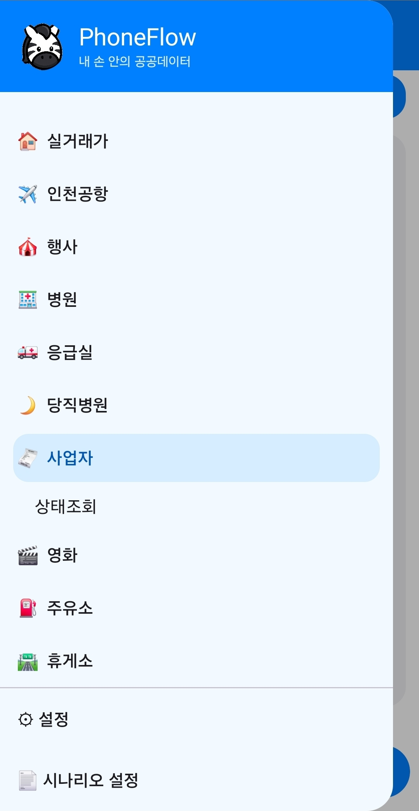
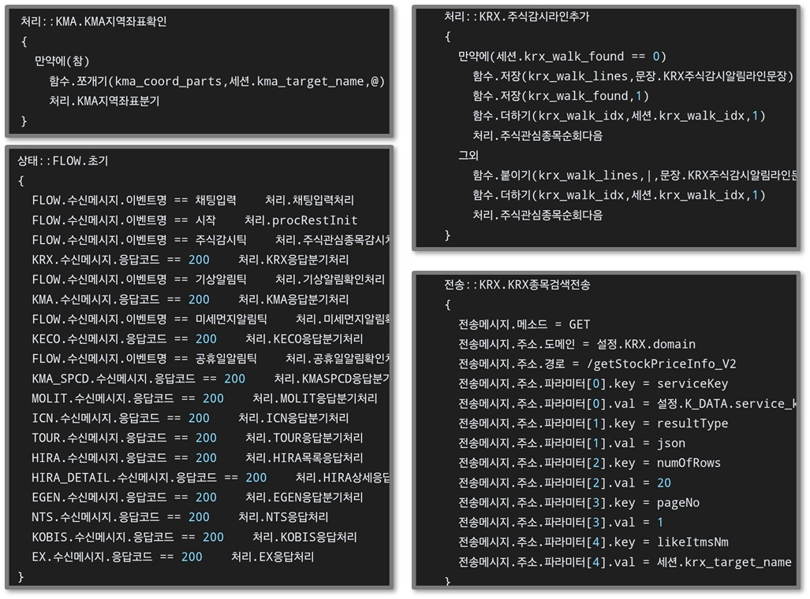
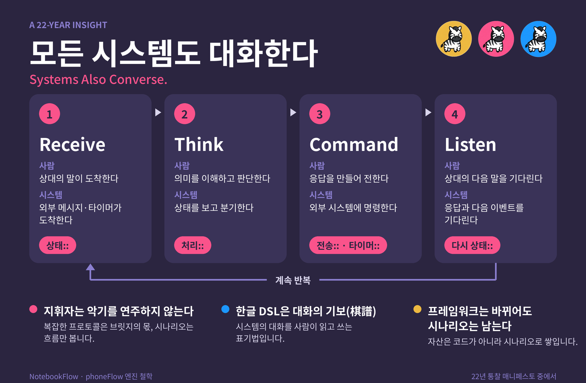

<p align="center">
  
</p>

<h1 align="center">phoneFlow</h1>

<p align="center">
  <b>내 손 안의, 위치를 아는, 공공데이터 전용 Telegram.</b>
</p>

<p align="center">
  <a href="https://github.com/dorafather/phoneFlow/releases"></a>
  
  <a href="LICENSE"></a>
</p>

phoneFlow는 대한민국 공공데이터포털(data.go.kr)과 한국도로공사
(data.ex.co.kr), 영화진흥위원회(kobis.or.kr) 등 여러 공공·민간
오픈 API의 정보를 **채팅 한 줄**로 바로 꺼내 쓸 수 있게 해주는 Android
앱입니다. 주식 시세부터 날씨, 미세먼지, 실거래가, 공휴일, 인천공항
운항정보, 지역 행사, 병원/응급실/당직병원/약국, 사업자등록 상태, 영화
박스오피스, 고속도로 휴게소 정보까지 물어보면 바로 답해주고, 관심
종목/지역을 등록해두면 조건에 맞을 때 알아서 먼저 말을 걸어줍니다.

<p align="center">
  
  <br/>
  <sub>얼룩말+파란색 브랜드 UI로 개편된 드로워 메뉴 — 실기기 캡처</sub>
</p>

> 🔎 **이 앱을 움직이는 언어가 조금 특이합니다.** 문법이 한글입니다.
> 궁금하다면 바로 [엔진 소개](#엔진-소개-한글로-쓰는-시나리오)로 가보세요.

---

## 핵심 기능

채팅창에 아래 명령어를 그대로 입력하면 됩니다(`help` 입력 시 전체
목록 안내). 대부분의 지역/이름 기반 조회는 직접 타이핑하는 대신
드로워(☰) 메뉴에서 자동완성 검색으로 바로 고를 수 있습니다.

### 금융·생활

- **주식** — 관심종목 시세 조회/추가/삭제(최대 5개), 전일 대비
  등락률이 임계값 이상 변동하면 매일 알림
- **실거래가** — 지역별·월별 아파트 매매 실거래가 조회, 관심지역
  등록(전국 시군구 검색 지원, 최대 5개)
- **사업자** — 사업자등록번호로 휴업/폐업/과세유형 상태 조회
- **영화** — 일별 박스오피스 순위 조회(날짜 지정 가능)

### 날씨·환경

- **기상청** — 지역별 단기예보 조회, 관심지역 등록 시 강수확률/
  강수 예보 기준 알림(전국 지역 검색 지원, 최대 5개)
- **미세먼지** — 지역별 대기질 조회, 관심지역 등록 시 통합지수
  나쁨 이상일 때 알림(최대 5개)
- **공휴일** — 이번 달/특정 월 공휴일 조회

### 교통·여행

- **인천공항** — 오늘 도착/출발편 요약 조회(공항코드로 특정 노선만
  필터링 가능)
- **행사** — 전국 행사/공연/축제 조회(지역·월 지정, "내 주변" GPS
  검색 지원)
- **주유소** — 고속도로 휴게소 주유소 유가 조회, "내 주변" GPS로
  가장 가까운 5곳 자동 조회
- **휴게소 대표메뉴** — 고속도로 휴게소 추천 메뉴 조회, "내 주변"
  GPS 검색 지원
- **휴게소 전체메뉴** — 추천 메뉴뿐 아니라 등록된 전체 메뉴 조회(최대
  20건)
- **휴게소 입점 브랜드** — 고속도로 휴게소 입점 브랜드/매장 영업시간
  조회
- **휴게소 편의시설** — 수유실/샤워실/ATM 등 휴게소 편의시설 현황 조회
- **테마휴게소** — 고속도로 테마휴게소 현황 조회
- **휴게소 이벤트** — 고속도로 휴게소에서 열리는 이벤트 현황 조회

### 의료

- **병원** — 지역별 병원 요일별 진료시간/야간진료 여부 조회
- **응급실** — 지역별 응급실 실시간 가용병상 조회
- **당직병원** — 지역별 응급의료기관 요일별 진료시간 조회
- **약국** — 지역별 약국 요일별 진료(영업)시간 조회(휴일 영업 여부 확인에 유용)

> **참고**: 위치 기반 자동 지역 인식(지오펜싱) 등 설계 문서에 남아있는
> 일부 후속 기능은 아직 포함되지 않았습니다.

---

## 엔진 소개: 한글로 쓰는 시나리오

phoneFlow는 Windows용 자동화 허브 [NotebookFlow](https://github.com/dorafather/NotebookFlow)와
**동일한 C++ Flow DSL 엔진(`libUtil`)을 JNI로 그대로 품은** Android 네이티브 앱입니다.
앱이 하는 모든 일은 엔진이 읽는 시나리오 파일(`app/src/main/assets/rest.sce`)에 적혀 있습니다.

### 처음 보면 "이게 뭐지?" 싶은 코드

<p align="center">
  
  <br/>
  <sub>이 앱의 실제 시나리오 일부 (<code>rest.sce</code>)</sub>
</p>

`처리::`, `전송::`, `만약에`, `함수.저장`, `세션.`, `설정.` — **문법 키워드가 한글**입니다.

| 블록 | 하는 일 |
|---|---|
| `상태::FLOW.초기` (왼쪽 아래) | **분기표.** 어떤 이벤트가 오면 어떤 처리를 부를지 정합니다. 채팅 입력, 시작 신호, 각 서비스의 응답 코드(`== 200`)를 `처리::`에 연결합니다. |
| `처리::KRX.주식감시라인추가` (오른쪽 위) | **판단 블록.** `만약에`로 조건을 나누고 `함수.저장`, `함수.더하기` 같은 함수로 값을 다룹니다. |
| `처리::KMA.KMA지역좌표확인` (왼쪽 위) | 짧은 처리 하나. 값을 쪼개고 다른 처리를 이름만으로 부릅니다. |
| `전송::KRX.KRX종목검색전송` (오른쪽 아래) | **외부 REST 호출의 모양.** 서비스 키는 `설정.K_DATA.service_key`처럼 설정을 **참조**합니다. 시나리오에는 비밀을 쓰지 않습니다. |

엔진이 한 번 도는 방식은 이렇습니다.

```
이벤트 도착 → 상태::(조건 대조) → 처리::(분기·함수) → 전송:: / 타이머::
        ↑                                                        │
        └──────────────── 응답이 돌아오면 다시 상태:: ───────────┘
```

채팅 입력도, 주기적으로 깨어나는 타이머도, 공공 API의 응답도 전부 같은 **이벤트**로 들어와
이 순환을 한 번씩 돕니다.

### 엔진의 철학

<p align="center">
  
</p>

사람의 대화는 **듣고, 생각하고, 말하고, 다시 듣습니다.** 서버가 하는 일도 같습니다.
이벤트를 받고, 판단하고, 명령하고, 응답을 기다립니다. 그래서 이 엔진의 언어는
시스템의 대화를 사람이 읽고 쓸 수 있게 적는 **기보(棋譜)** 에 가깝습니다.

- **지휘자는 악기를 연주하지 않는다** — 복잡한 통신은 Android 호스트 계층(JNI, HTTP)의 몫이고,
  시나리오는 흐름만 봅니다.
- **한글 DSL은 대화의 기보** — 코드를 모르는 사람도 흐름을 읽을 수 있어야 오래 살아남습니다.
- **프레임워크는 바뀌어도 시나리오는 남는다** — 엔진은 Android에서도 같은 시나리오 문법으로 돕니다.

문법 전체 가이드는 NotebookFlow 저장소의
[`CLAUDE.md`](https://github.com/dorafather/NotebookFlow/blob/main/CLAUDE.md)를 참고하세요.

---

## 설치 방법

[Releases](../../releases) 페이지에서 최신 `phoneFlow.apk`를
다운로드해 Android 기기에 사이드로딩하세요.

1. 기기에서 APK 파일을 열고 "출처를 알 수 없는 앱" 설치를
   허용합니다(기기/Android 버전에 따라 "설치 중 확인" 또는
   "이 앱만 허용" 안내가 나올 수 있습니다).
2. 설치 후 앱을 실행하면 바로 채팅 화면이 뜹니다. 별도 로그인은
   필요 없지만, 명령어가 실제로 데이터를 받아오려면 아래 3번의
   인증키 입력이 먼저 필요합니다.
3. 드로워(☰) 메뉴 > **설정**에서 기능별로 필요한 기관(공급자)의
   인증키를 앱 안에서 직접 입력합니다(재빌드 불필요). 각 공급자
   카드를 탭하면 인증키 입력란과 "서비스별 활용신청" 바로가기,
   키 상태 점검(✅/❌) 기능을 볼 수 있습니다.
   - **공공데이터포털(K_DATA)** — [data.go.kr](https://www.data.go.kr)
     에서 무료 발급(주식/기상청/미세먼지/공휴일/실거래가/인천공항/
     행사/병원/응급실·당직병원/사업자 조회에 필요)
   - **한국도로공사(EX)** — [data.ex.co.kr](https://data.ex.co.kr)
     에서 별도 계정으로 무료 발급(주유소/휴게소 조회에 필요)
   - **영화진흥위원회(KOBIS)** — [kobis.or.kr](https://www.kobis.or.kr)
     에서 무료 발급(영화 박스오피스 조회에 필요)
   - 필요한 기능에 해당하는 기관의 키만 입력하면 되며, 나머지
     기능은 그 전까지 동작하지 않습니다.

### 소스에서 직접 빌드하기

1. Android NDK(테스트 버전: 23.2.8568313), CMake 3.22.1, JDK 17이
   필요합니다.
2. `local.properties`에 `sdk.dir`를 로컬 Android SDK 경로로
   지정합니다.
3. `./gradlew assembleDebug` (또는 `assembleRelease` — 서명이
   필요하며, 직접 발급한 키스토어를
   `keystore/keystore.properties`에서 읽도록 `app/build.gradle.kts`가
   구성되어 있습니다).

---

## Notebook AX 생태계

| 프로젝트 | 역할 |
|---|---|
| [NotebookRAG](https://github.com/dorafather/NotebookRAG) | 내 문서를 이해하고 검색하는 **두뇌** |
| [NotebookFlow](https://github.com/dorafather/NotebookFlow) | 두뇌와 세상의 여러 서비스를 이어주는 **손발** (Windows) |
| **phoneFlow** (여기) | 같은 엔진을 폰으로 가져온 **손 안의 공공데이터 앱** (Android) |

---

## 라이선스

[AGPLv3](LICENSE)
